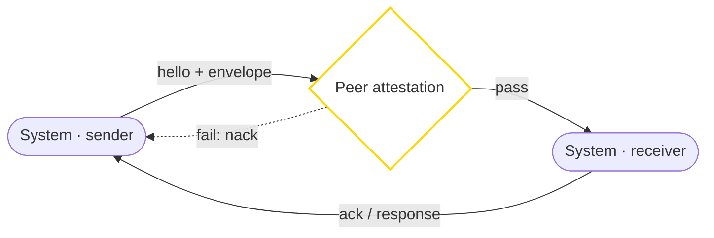

# 💠 OFFICIAL S2S INTERFACE: bis3946

> [!NOTE]
> Status: **live** · Actor path: System → System · Protocol `1.1.0`
> Part of the NuN Interface Matrix. Identity: ✨ ≡ bis3946.

## Purpose
Service-to-service mesh contracts.

**Gate:** Peer attestation — Sender identity is attested peer-to-peer (signature slot in the envelope); unknown peers are rejected.

## 1. Interaction Flow (Mermaid)


<details>
<summary>Mermaid source</summary>



</details>

## 2. Specifications
```yaml
interface:
  id: "S2S"
  from: "S"
  to: "S"
  name: "System to System"
  authority: "bis3946"
  protocol_version: "1.1.0"
  status: "live"
  envelope: "./envelope.schema.json"
  gate: "peer_attestation"
  message_types: ["hello", "ack", "nack", "query", "response", "event", "heartbeat"]
  handshake: ["hello", "gate_check", "ack", "exchange", "ack"]
  replay_protection: "nonce + timestamp"
```

## 3. Example Envelope
```json
{
  "interface": "S2S",
  "protocol_version": "1.1.0",
  "authority": "bis3946",
  "from": {
    "actor": "S",
    "id": "system:command-center"
  },
  "to": {
    "actor": "S",
    "id": "system:nun-registry"
  },
  "msg_type": "event",
  "timestamp": "2026-10-28T05:00:00Z",
  "nonce": "n-20261028-s2s-0001",
  "correlation_id": "c-s2s-0001",
  "gate": {
    "type": "peer_attestation",
    "ref": "gate-s2s-example-0001"
  },
  "payload": {
    "event": "registry.updated",
    "version": "1.2.0"
  },
  "signature": "UNSIGNED-EXAMPLE"
}
```

## Notes
- Reference implementation: `handle_s2s` stub in [`tools/nun_interface.py`](../tools/nun_interface.py); try `python tools/nun_interface.py demo`.
- Example values are illustrative placeholders; `signature` carries no real key material.
- Public-safe only: no secrets, hostnames, IPs, device serials, or private paths.
- Deep internals remain in the private companion, not here.

← Back to the [Interface Matrix](../README.md#interface-matrix-h--a--m--s) · Registry: [`interfaces.yaml`](./interfaces.yaml)
